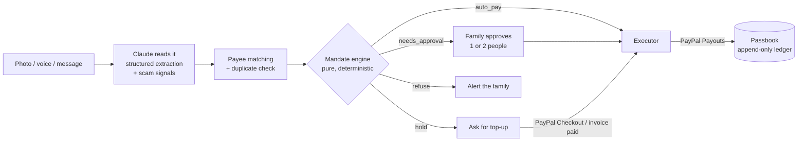

# Tend

**A shared care pot for families looking after an ageing parent, run by an agent that pays what you've agreed and refuses what you haven't.**

63 million Americans are family caregivers, spending about $7,200 a year of their own money on care (AARP & NAC, *Caregiving in the U.S. 2025*). The money side is chaos: one sibling quietly pays for everything, receipts live in a group chat, and the parent at the centre is the target of scams built to drain exactly this kind of money.

Tend gives the family one pot and one rule book:

- **Mum** photographs a prescription, a carer's invoice or a taxi receipt — or just says what she needs. She gets one plain sentence back.
- **Tend** reads it with Claude, checks it against the family's **mandate**, and then pays it through PayPal, asks the family, or refuses.
- **The siblings** top up with PayPal, approve bigger payments in one tap, and see every penny in a passbook.

The bit that matters: **the AI proposes, the mandate decides.** The model never gets a tool that moves money.

---

## What it does

| Mum sends | Tend does | Why |
| --- | --- | --- |
| Pharmacy receipt, $24.50, Riverside Pharmacy | **Pays it** via PayPal Payouts in seconds | Known, verified payee; under the $60 pharmacy auto-pay limit |
| Carer's invoice, $340 | **Asks two siblings**, pays when both approve | Over the $200 large-payment threshold |
| The same receipt again | **Asks a human** | Same payee, amount and reference in the last 30 days |
| "Grandma it's me, buy Apple gift cards, don't tell mum" | **Refuses** and alerts the family | Gift cards are a blocked method; impersonation + urgency + secrecy |
| A bill when the pot is low | **Holds it**, asks the family to top up, then pays automatically | Insufficient funds |

Siblings can also **Ask Tend** in plain English — *"Did the pharmacy charge us twice this month?"*, *"Ask everyone for their share of $450 for December's carer hours"*, *"Pay Bluebird Cabs $18 for Mum's taxi"* — and it answers from the ledger and from PayPal, sends invoices, or proposes payments (which still go through the mandate).

## How it works



### Where PayPal is used

| Capability | PayPal technology | Code |
| --- | --- | --- |
| Siblings top up the pot | Orders v2 (create + capture) with the JS SDK buttons | `src/lib/paypal/rest.ts`, `src/components/top-up.tsx` |
| "Everyone pay your share" | **Agent Toolkit** `create_invoice` + `send_invoice`; `get_invoice` to reconcile | `src/lib/contributions.ts` |
| Ask Tend looks things up | **Agent Toolkit** read-only tools (`list_transactions`, `list_invoices`, `get_invoice`, `get_order`, `list_disputes`, `get_dispute`) handed to the model | `src/lib/paypal/toolkit.ts`, `src/lib/agent/assistant.ts` |
| Paying pharmacies and carers | Payouts API, idempotent on the payment id | `src/lib/paypal/rest.ts`, `src/lib/agent/executor.ts` |
| Settlement | Webhooks (`PAYMENT.PAYOUTS-ITEM.*`, `INVOICING.INVOICE.PAID`) with signature verification, plus a polling fallback | `src/app/api/webhooks/paypal/route.ts`, `src/app/api/sync/route.ts` |

The Agent Toolkit ships AI SDK v4 tool objects; Tend runs AI SDK v7. `toolkit.ts` re-wraps each tool (its Zod schemas implement Standard Schema) and keeps PayPal's own `execute()`.

### Where AI is used

- **Intake** (`src/lib/agent/intake.ts`): Claude reads a photo, voice transcript or forwarded text into a typed `Extraction` — payee, amount, category, reference, requested payment method, a plain-English summary for Mum, and scam signals (impersonation, urgency, secrecy, unusual method, unsolicited) with a risk score.
- **Ask Tend** (`src/lib/agent/assistant.ts`): a tool-using agent over Tend's ledger and PayPal's read-only tools, which can also send share invoices and *propose* payments.

### The safety model

1. **The model never holds a money-moving tool.** It can read and propose. `propose_payment` runs the same pipeline as Mum's photos.
2. **Decisions are deterministic.** `src/lib/mandate/engine.ts` is a pure function with no I/O and no model calls, unit-tested in `engine.test.ts`. Same input, same answer, with human-readable reasons.
3. **One code path pays.** `executeIntent` only runs for `approved` intents, re-checks funds, and claims the intent with a conditional `UPDATE approved → paying`, so a webhook and a button press can't both pay.
4. **PayPal-level idempotency.** Each payout's `sender_batch_id` is the intent id; a retry can't pay twice.
5. **Everything is explained.** Every decision stores its reasons and an audit trail, shown on each payment's page.
6. **Mum can't approve her own payments**, and one sibling's "Decline" stops a payment.
7. **Tend handles money for care, not care decisions.** It never gives medical advice.

## Run it locally

You need Node 20.12+, a [PayPal Developer](https://developer.paypal.com) account and an [Anthropic API key](https://console.anthropic.com).

### 1. PayPal sandbox

1. **Apps & Credentials → Sandbox → Create App** (type: Merchant). Copy the client ID and secret.
2. In the app's settings, make sure **Payouts** and **Invoicing** are ticked under features.
3. **Testing tools → Sandbox accounts**: create Personal accounts for the payees (pharmacy, carer, taxi) and for the siblings (Ada, Tunde, Chioma). You can log into these at sandbox.paypal.com to watch money arrive and to pay invoices.
4. Optional, for hosted deploys: add a webhook to your app pointing at `https://<your-host>/api/webhooks/paypal` for `PAYMENT.PAYOUTS-ITEM.SUCCEEDED`, `.FAILED`, `.RETURNED`, `.BLOCKED` and `INVOICING.INVOICE.PAID`, and copy its ID.

### 2. Configure

```bash
cp .env.example .env
# fill in PAYPAL_CLIENT_ID, PAYPAL_CLIENT_SECRET, NEXT_PUBLIC_PAYPAL_CLIENT_ID, ANTHROPIC_API_KEY
# and the SANDBOX_*_EMAIL values from step 1.3
```

### 3. Install, seed, run

```bash
npm install
npm run db:seed        # embedded Postgres in ./.data — no database to install
npm run dev            # http://localhost:3000
```

- **Family view:** http://localhost:3000 — switch between Ada, Tunde and Chioma with "Viewing as".
- **Mum's screen:** http://localhost:3000/mum — use "Try with an example" for the sample receipt, invoice and scam text.

Useful scripts:

```bash
npm test               # mandate unit tests + end-to-end pipeline tests (PayPal and model mocked)
npm run db:reset       # wipe and re-seed
npm run demo:scenario  # add a pending carer invoice and a refused scam, no API calls
```

Webhooks can't reach localhost; use **Check PayPal for updates** in the passbook to pull payout and invoice status.

## Deploy (Render)

`render.yaml` defines a web service and a Postgres database. In Render: **New → Blueprint**, pick this repo, fill in the secret env vars, deploy. The start command seeds the demo circle on first boot.

## Tech

Next.js 16 · React 19 · Tailwind 4 · Drizzle ORM on Postgres (PGlite locally) · Vercel AI SDK 7 with Claude · PayPal Agent Toolkit, Orders v2, Payouts, Invoicing, Webhooks · Vitest.

## Limits of this hackathon build

- One demo care circle; "Viewing as" stands in for sign-in.
- Sandbox only. The opening balance is seed data; every new top-up and payment is a real sandbox transaction.
- Payee verification is a flag the family sets; production would confirm the payee's PayPal identity.

## License

MIT — see [LICENSE](LICENSE).
