# Tend

**Their money, their say. A second key for the people they trust.**

Tend lets an older adult keep paying from their own PayPal, and gives the people they trust time to stop anything that looks wrong. Routine bills go straight through. Anything unusual is **authorized but held** in their PayPal: for a day if it's simply new or large, until someone says yes if it shows warning signs. Anyone in their circle can stop it, and PayPal voids the hold so the money never leaves. Gift cards, crypto, wire transfers and clear scams are refused before any money moves. Built on **PayPal** (Orders authorize/capture/void, Vault, Payouts, Invoicing, Agent Toolkit, JS SDK v6, Webhooks), with an **AI model** reading every request (Claude Sonnet 5.5 by default, on the Claude API; any model through OpenRouter), and an **AG Studio** dashboard for the circle.

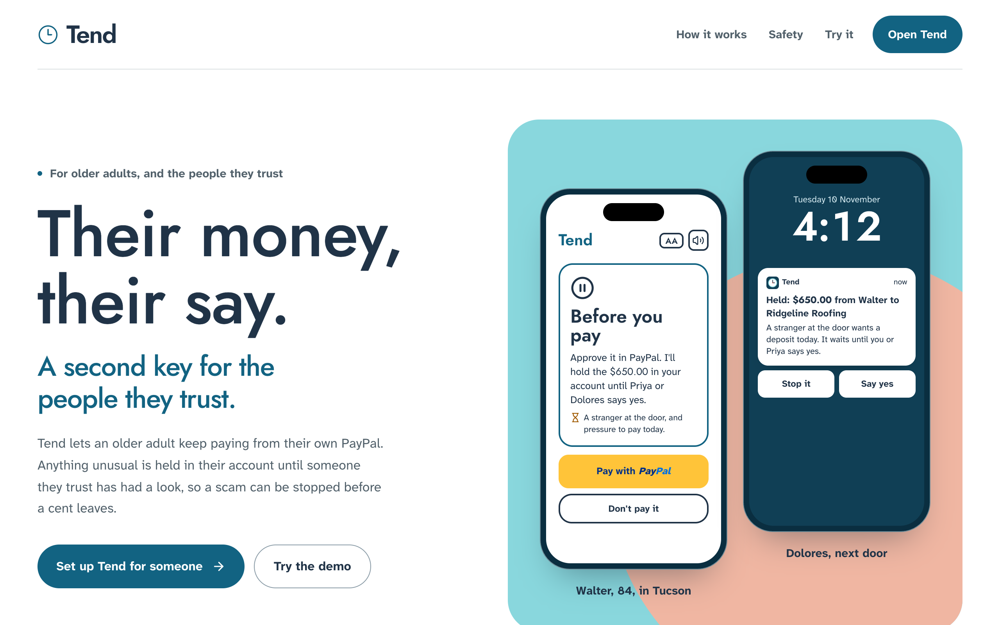

## The problem

- People over 60 reported **$7.75 billion** in fraud losses to the FBI in 2025, **up 59%** on 2024. The average loss was **$38,500**. (FBI IC3 2025 report)
- Scammers now use **PayPal's own invoices and money requests**. The email really is from PayPal; the trap is a "support" phone number typed into the note. PayPal's help centre warns about it.
- **Time breaks scams.** Since October 2024, UK banks may **hold a suspicious payment for up to four business days** (FCA FG24/6). The people an older adult trusts have no such power over their payments.
- Brokerages must ask for a **trusted contact** (FINRA Rule 4512). Everyday payment apps have no such role.
- **26% of Americans 65+ live alone** (Pew). Many have no children, or none nearby, and are the least served.

The usual answers take control away: a joint account, power of attorney, a card someone else manages. Tend keeps the person in charge and adds one thing: **time for a second look**.

## Two circles, two stories

| | **Walter's circle** | **The Okafor family** |
| --- | --- | --- |
| Who | Walter, 84, lives alone in Tucson. No children. His niece Priya in Seattle and his neighbour Dolores are his second key | Mum in Houston. Her children Ada, Tunde and Chioma in London, Toronto and Lagos |
| Money | Walter's **own PayPal**. Nobody else can spend it | Walter's model, plus a **shared care pot** the children pay into |
| What Tend does | Pays his routine bills; **holds** anything unusual (for a day, or until someone says yes if it looks wrong); refuses scams; tells Priya and Dolores, whoever is awake | Pays care bills from the pot within the family's rules; asks whoever is awake about bigger ones; collects shares by PayPal invoice; gets double payments back |

| Walter's screen | Before he pays a stranger at the door | A real PayPal invoice with a fake number | Dolores, next door |
| --- | --- | --- | --- |
| 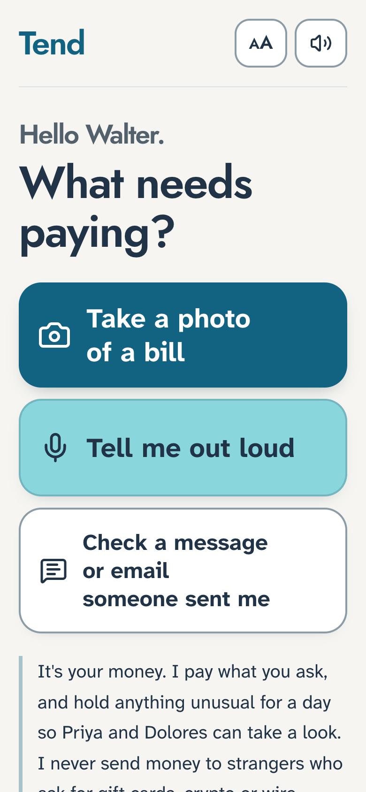 | 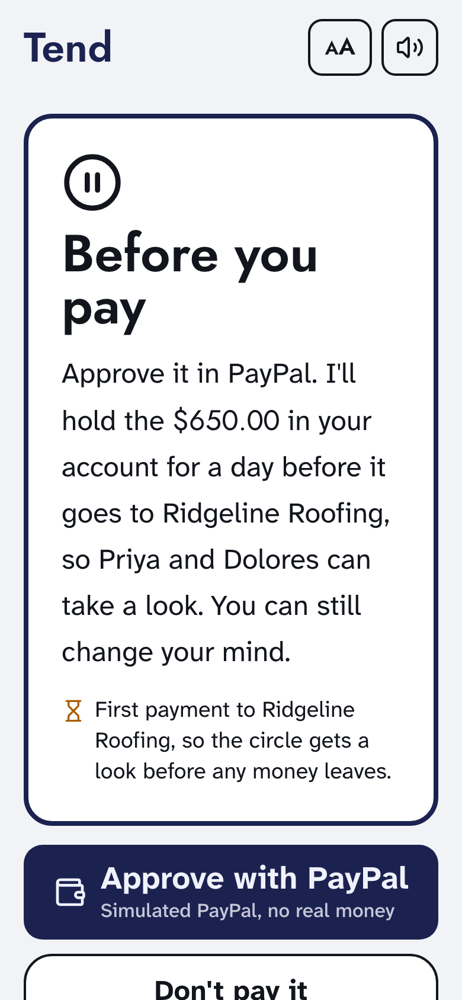 | 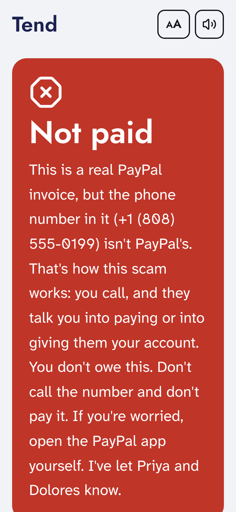 | 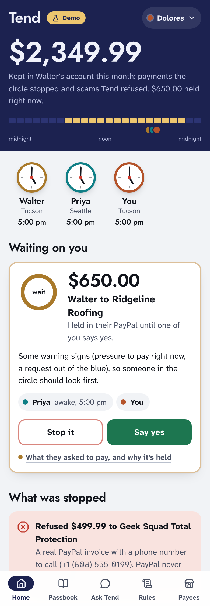 |

## Try it in two minutes (no keys needed)

```bash
npm install
npm run db:seed      # embedded Postgres in ./.data, nothing to install
npm run dev          # http://localhost:3000
```

With no keys Tend runs in **demo mode**: PayPal is simulated (every order, authorization, payout and invoice gets a `SIM-` id and is labelled), and messages are read by a keyword reader instead of the AI model. Everything else is the real code: the rules engine, holds, approvals, the ledger, the MCP server. `/setup` ("What's connected") shows which key switches on what.

**Walter's story (the second key)**

1. On `/`, tap **Try the demo** and pick **Walter** (or open `/join/walter`). Open **Try it with an example** and send **Pharmacy refill**. Approve with PayPal: it's paid at once, because Walter has paid Saguaro Pharmacy before.
2. Send **A roofer at the door** (a stranger wants a $650 deposit today). Tend explains it will hold the money in Walter's PayPal until Priya or Dolores says yes. Approve with PayPal: **Held for now**.
3. Open `/join/dolores` in another browser or phone (or **Settings → Open as someone else**). The held payment is at the top, and if Dolores's screen was already open, a banner slid in when it was held. Tap **Stop it**: PayPal voids the authorization and the money never left. (**Say yes** would let it go.)
4. As Walter, send **A PayPal invoice email**. Tend recognises the fake support number: *"You don't owe this. Don't call the number."*
5. Send **A Medicare card fee**. Someone posing as Medicare, which never charges for a card: Tend refuses it and tells Priya and Dolores.
6. As Priya, open **Ask Tend** and ask *"Is anything of Walter's held right now?"*, then say *"stop it"*.
7. Still as Priya, open **Passbook → Dashboard**: twelve weeks of Walter's money, what Tend kept safe, and who stepped in. Click **Build your own** and ask the assistant *"Which week did we stop the most?"*. Save it for the circle.

**The Okafor family (a shared care pot)**, under **More examples** on `/demo`

1. Pick **Mum** and send the **Carer's invoice**. Tend asks the family and says who's awake. Approve as Ada, then open `/join/tunde` and approve again. It's paid by PayPal Payout.
2. As Mum, send **A worrying text** (a "grandchild" asking for gift cards). Refused, and the family is told.
3. On the family home, **Money to get back** shows a pharmacy bill paid twice. Ask for it back: Tend sends the pharmacy a PayPal invoice.
4. In **Passbook**, ask *"pharmacy payments this month"*.

**Reset the demo** on `/demo` (or in Settings, in an example circle) puts both example circles back. Circles people set up themselves are never touched, and everyone stays signed in.

## Make it real (PayPal sandbox + an AI model)

Copy `.env.example` to `.env` and fill in what you have. Each key switches one part to the real thing.

| Key | Where | Switches on |
| --- | --- | --- |
| `OPENROUTER_API_KEY` or `ANTHROPIC_API_KEY` | openrouter.ai → Keys (any model; `TEND_MODEL` picks it), or console.anthropic.com | The AI reads photos, voice and texts; Ask Tend becomes a tool-using agent; rules and passbook questions in plain English |
| `PAYPAL_CLIENT_ID`, `PAYPAL_CLIENT_SECRET` | developer.paypal.com → Apps & Credentials → **Sandbox** → a Merchant app with **Payouts**, **Invoicing** and **Vault** ticked | Real sandbox authorizations, captures, voids, payouts, invoices and saved wallets. The JS SDK v6 buttons get a client token from the server, so no public client ID is needed |
| `SANDBOX_*_EMAIL` | developer.paypal.com → Testing tools → Sandbox accounts (one Personal account can be reused) | Where payouts and share invoices go, and the accounts Mum and Walter approve with. Run `npm run db:reset` after setting them |
| `PAYPAL_WEBHOOK_ID` | your sandbox app's webhooks, once deployed | Signature-verified webhooks; locally Tend polls instead |
| `CHANNEL3_API_KEY` | trychannel3.com (free tier) | Shopping searches real retailers instead of a sample catalogue |
| `TEND_MCP_TOKEN` | any secret you choose | Requires a bearer token on the MCP server (it is open in demo and sandbox mode, closed on live PayPal without one) |

## How the second key works


| Walter sends | Tend does | Why |
| --- | --- | --- |
| Pharmacy refill, $38.20 | **Pays it** straight away | Paid before, under $150 |
| $120 to a plumber he booked himself | **Holds it for a day**; Priya and Dolores can stop it or let it go now | First payment to someone new |
| A roofer at the door wants a $650 deposit today | **Holds it until someone says yes**; voided after three days if nobody answers | Warning signs: a stranger, pressure to pay today. It might be a real roofer, so the circle checks |
| "Medicare Card Services: pay the $89 replacement fee" | **Refuses** and alerts the circle | Someone posing as Medicare, which never charges for a card |
| A real PayPal invoice with a phone number in the note | **Refuses**: "You don't owe this. Don't call the number." | PayPal never puts a support number in an invoice note |
| "It's me, buy gift cards, don't tell anyone" | **Refuses** and alerts the circle | Gift cards are blocked; impersonation, secrecy |
| Anything over $1,000 | **Holds it until someone says yes** | The circle's rule |

The circle sets the rules (hold length 12 to 71 hours, the amounts, holding new payees) on `/rules`, by hand or in a sentence: *"hold anything over $200 for 2 days"*. Holds never exceed 71 hours, inside PayPal's three-day honor period for capturing an authorization. A needs-a-yes payment that nobody answers is voided after three days, so silence never pays.

Tend refuses outright only on a sign with no innocent version: someone posing as family or an official, a request for secrecy, gift cards, crypto or wire, or a phone number in a PayPal invoice. A high scam score alone never refuses. It waits for a yes, so a real roofer can still be paid.

## Where PayPal is used

| Capability | PayPal technology | Code |
| --- | --- | --- |
| The cooling-off hold | **Orders v2** with `intent: AUTHORIZE`; **Authorizations** capture and void | `src/lib/own-payments.ts`, `src/lib/paypal/rest.ts` |
| The person approves a payment or a top-up | **JS SDK v6** (`createInstance`, `findEligibleMethods`, PayPal one-time payment session) with a server-made **client token** | `src/components/paypal-approve.tsx`, `src/app/api/paypal/client-token/route.ts` |
| Regular bills without a PayPal screen each time | **Vault / Payment Method Tokens v3** (setup token → payment token), charged with `payment_source.paypal.vault_id`, only to payees and amounts the person agreed | `src/lib/vault.ts` |
| Paying pharmacies, carers and payees on release | **Payouts**, idempotent on the payment id | `src/lib/agent/executor.ts`, `src/lib/own-payments.ts` |
| Verifying a new payee | **Payouts**: one cent with a four-digit code in the note | `src/lib/payees.ts` |
| Siblings paying their share; getting a double payment back | **Agent Toolkit** `create_invoice`, `send_invoice`, `get_invoice` | `src/lib/contributions.ts`, `src/lib/recoveries.ts` |
| Ask Tend looks things up | **Agent Toolkit** read-only tools (`list_transactions`, `list_invoices`, `get_invoice`, `get_order`, `list_disputes`, `get_dispute`) | `src/lib/paypal/toolkit.ts`, `src/lib/agent/assistant.ts` |
| Settlement | **Webhooks** (`PAYMENT.PAYOUTS-ITEM.*`, `INVOICING.INVOICE.PAID`, `PAYMENT.AUTHORIZATION.VOIDED`, `PAYMENT.CAPTURE.COMPLETED`) with signature verification, each recorded once in that payment's history, plus polling and a cron job that also releases holds that have ended | `src/app/api/webhooks/paypal/route.ts`, `src/app/api/sync/route.ts` |
| Spotting scams that use PayPal itself | The AI's extraction marks real PayPal invoices and money requests that carry a phone number; the rules engine refuses them with a PayPal-specific reason | `src/lib/agent/intake.ts`, `src/lib/mandate/engine.ts` |

The Agent Toolkit ships AI SDK v4 tool objects; Tend runs AI SDK v7. `toolkit.ts` re-wraps each tool and keeps PayPal's own `execute()`. Tools that create or send invoices are only ever called by Tend's server code, never handed to the model.

## Where AI is used

Every AI call goes through the Vercel AI SDK (`src/lib/agent/model.ts`), so the model is a setting, not a dependency. The default is Claude Sonnet 5.5: `claude-sonnet-5-5` with an Anthropic key (`ANTHROPIC_API_KEY`, used first when both are set), or `anthropic/claude-sonnet-5.5` through OpenRouter. The voice always uses OpenRouter, so a deploy can run the model on the Claude API and the voice on OpenRouter. Set `TEND_MODEL` to any model with image input, tool calls and structured output.

- **Reading** (`src/lib/agent/intake.ts`): a photo, voice transcript or forwarded message becomes a typed extraction: payee, amount, category, reference, the payment method asked for, a one-sentence summary for the person, scam signals with a risk score, and whether it's a PayPal-native invoice or money request with a phone number to call.
- **Ask Tend** (`src/lib/agent/assistant.ts`): a tool-using agent over the ledger, held payments, everyone's clocks, the duplicate hunter, shopping and PayPal's read-only tools. It can stop a held payment; it can only *propose* payments and rule changes.
- **Rules in plain English** (`src/lib/rules.ts`) and **questions to the passbook** (`src/lib/agent/passbook-query.ts`): the model returns structured changes or filters; pure code validates them; a person saves.
- **Shopping** (`src/lib/shopping.ts`): the model picks one of three in-stock options and says why. Buying goes through the rules like any bill.
- **Spoken answers** (`src/lib/voice.ts`, `src/app/api/speak/route.ts`): the person's screen reads every answer aloud in a natural voice from OpenRouter's speech endpoint (Microsoft MAI Voice 2.1 by default; `TEND_VOICE_MODEL` and `TEND_VOICE` pick another), cached per line, with the browser's own best voice as the fallback.
- **The dashboard assistant** (`src/app/api/studio/ai/route.ts`, `src/lib/agent/studio-turn.ts`): AG Studio's own agents run their loop in the browser and build widgets with AG Studio's tools; each turn goes to Tend's server and runs on the same model, so no key reaches the page. Same-origin only, with size and rate limits.

Each has an offline stand-in (`src/lib/agent/offline.ts`), labelled wherever it answers. `npm run eval:intake` scores the reader on 21 real-looking inputs, including PayPal invoice and money-request scams, a Medicare card fee, a roofer at the door and messages that only mention money, and checks whether the rules would refuse each one or let the circle check it. Claude Sonnet 5.5 scores 21/21, both on the Claude API and through OpenRouter; the offline reader 19/19 (the two photos need Claude).

## Tend as an MCP server

Any assistant about to help someone pay can ask the circle's second key first. Tend serves MCP over Streamable HTTP at `/api/mcp` (`src/lib/mcp/server.ts`):

| Tool | Does |
| --- | --- |
| `check_payment_request` | Reads a bill, invoice, text or email and says what Tend would do: pay, hold, wait for a yes, or refuse, with reasons. Saves nothing |
| `list_held_payments`, `circle_overview`, `explain_payment` | What's held and why, what was stopped, and every step PayPal and the circle took |
| `search_passbook`, `get_rules`, `list_circles` | The ledger in plain words, the circle's rules, who's awake |
| `stop_held_payment` | The only action: voids a held authorization, for a named person in the circle. Nothing here can send money |

```bash
claude mcp add --transport http tend http://localhost:3000/api/mcp
npm run mcp:demo     # a scripted session against any Tend URL (TEND_URL=...)
```

In Claude.ai or Claude Desktop: Settings → Connectors → Add custom connector, and paste the deployed `/api/mcp` URL.

## Sponsor tools

- **AG Studio**, AG Grid's embedded analytics (`src/components/circle-dashboard.tsx`, `src/lib/report.ts`): the circle's dashboard at `/passbook/dashboard`. Three data sources built from the ledger (every payment and what happened to it, every time someone in the circle stepped in, and shares paid into a pot). It opens on a finished report: figures, a stacked weekly chart of what happened to the money, donuts, grids, page filters and cross-filtering, with Tend's theme, its person-colour palette and a phone layout. **Build your own** gives the circle drag-and-drop editing and **AG Studio's AI assistant**, connected to Tend's model through a custom `AgLlmAdapter`. A dashboard someone builds can be **saved for the whole circle** (one per circle, in Postgres) or reset to Tend's. Without `AG_GRID_LICENSE_KEY` it runs as a full trial with a watermark.
- **AG Grid Community** (`src/components/passbook-grid.tsx`): the passbook explorer, themed from Tend's tokens with the Theming API. Natural-language questions become an **external filter** with removable chips; a **pinned totals row** recomputes on every filter and keeps money that was held, stopped or refused out of the totals; status pills; struck-through amounts for money that never left; quick search; per-column filters; CSV export; person-coloured cells; responsive columns (one signed Amount column on phones); circles without a pot hide the pot-only columns.
- **Render** (`render.yaml`): one Blueprint creates Postgres, the web service (health-checked at `/api/health`, seeds both demo circles on first boot) and a cron job that calls `/api/sync` every five minutes to settle payouts and **release holds that have ended**. If `DATABASE_URL` ever stops answering (free Render Postgres expires after 30 days), Tend falls back to its embedded database, reseeds the demo and says so on `/api/health`, instead of going dark mid-judging.
- **Channel3** (`src/lib/shopping.ts`): product search across retailers for the shopping agent.

| Dashboard (AG Studio): where Walter's money went | Dashboard: the second key at work |
| --- | --- |
| 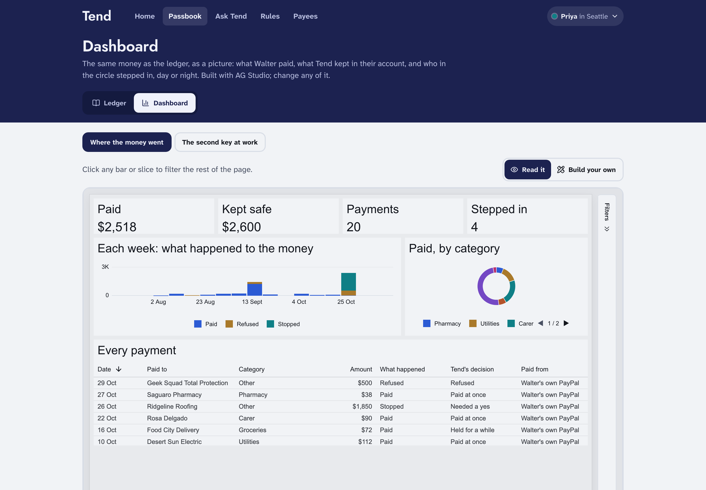 | 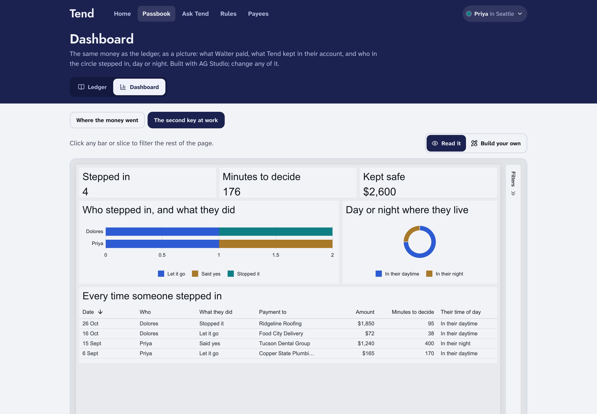 |

| Passbook (Walter's circle) | Passbook (a shared pot, dark) |
| --- | --- |
| 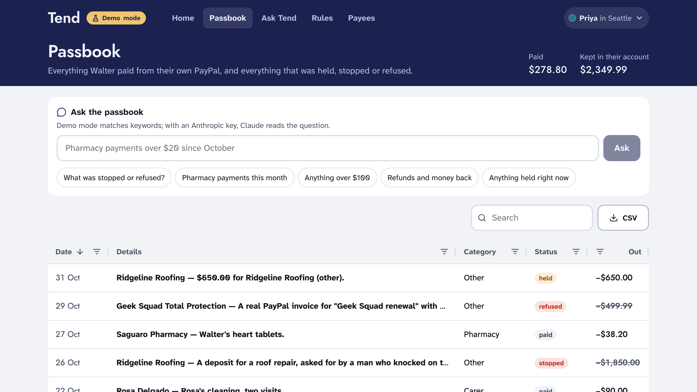 | 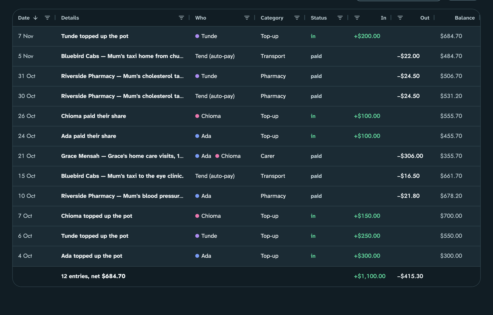 |

## Signing in, alerts and setting up

- **Sign in by invite link** (`src/lib/session.ts`, `/join/[token]`): everyone gets into Tend from their own link, which carries a signed token (HMAC of their id, so it can't be made up from an id seen on a page). Opening it signs them in on that device with a signed, HttpOnly session cookie for a year. Pages need a session (`/signin` explains where to get one), the person at the centre only ever sees their own screen, and every API request that names who is acting (`memberId`, `payerId`, `submittedBy`) must be the person signed in, or it gets a 401/403. **Settings** shows each person's link to send again, and **Sign out**. The secret comes from `TEND_SESSION_SECRET` or is made once and kept in the database.
- **A Home Screen app** (`/manifest.webmanifest`): added from a signed-in page, the app's start link is that person's own invite link, so it opens on their screen and stays signed in, even on an iPhone, where a Home Screen app keeps its own cookies. The demo people keep the same ids across a reset, so installed apps keep working.
- **The example circles live behind their own door** (`/demo`): open them as anyone, try the examples, reset them. The front page shows Walter's circle; a real circle never shows any of this.

- **Alerts on the circle's phones** (`src/lib/push.ts`, `public/sw.js`): when Tend holds a payment or stops a scam, everyone in the circle who turned alerts on gets a Web Push notification. A held payment carries **Stop it** and **Say yes**, which act from the notification without opening Tend (Android and desktop; an iPhone shows the alert without buttons, and a tap opens the payment). The person at the centre is never buzzed. iPhones need Tend on the Home Screen first; the iOS Simulator can't receive web push at all.
- **The same moment inside the app** (`src/components/live-alert.tsx`, `/api/alerts/live`): any circle screen that's open gets a banner the moment something is held or refused, and brings itself up to date, on any device, alerts on or not. Keys are made once and kept in the database (or set `VAPID_PUBLIC_KEY` / `VAPID_PRIVATE_KEY`).
- **Set up Tend for someone** (`/start`, `src/lib/onboarding.ts`): four short steps (who it's for, who their second key is, how careful, check it over) create a real circle with its own rules, and give everyone their own invite link. The new circle's home starts with a short list: send their link, add who they pay, turn on alerts. The example people also answer to their first names (`/join/walter`, `/join/dolores`); real circles only open with the signed link.

## The safety model

1. **The person stays in charge.** Tend never refuses an ordinary payment from their own money. It holds unusual ones, and only for as long as the circle agreed.
2. **The model never holds a money-moving tool.** It reads and proposes. In Ask Tend and over MCP, the only action is stopping a held payment.
3. **Decisions are deterministic.** `src/lib/mandate/engine.ts` is a pure function: same input, same answer, with reasons in plain words. Precedence is refuse > needs a yes > hold > pay.
4. **Holds are PayPal's, not Tend's.** The money sits in the person's account as an authorization. Stopping it is a PayPal void; nothing to claw back.
5. **Silence never pays a risky payment.** A needs-a-yes payment is voided after three days if nobody answers. A cooling-off hold releases only after its time runs out, and anyone can stop it until then.
6. **The rules are versioned and guarded.** Every change is a new version with who changed what; loosening changes are flagged; gift cards can never be unblocked; the person at the centre can't approve their own risky payments.
7. **One code path pays,** claiming each payment with a conditional update so a webhook, a cron job and a button press can't both pay. Each payout's `sender_batch_id` is the payment id.
8. **Vault consent is narrow.** A saved PayPal pays only the payees the person ticked, only up to the amount they set, and they can revoke it.
9. **Everything explains itself,** with an audit trail stamped in each person's own time zone.
10. **Tend handles money, not care decisions.** It never gives medical or financial advice.

## Design: the clock wall

Diaspora homes and bank halls have a row of clocks labelled with cities. Tend's interface is that wall: one live dial per person, night indigo when they're asleep, so a held payment always says who can look *now*. Each person keeps one colour everywhere. Amounts and times share one numeral system (Jost). Every line people read uses Atkinson Hyperlegible Next, designed for low-vision readers. The person's own screen has three big actions, three text sizes and answers read aloud in a natural voice. Light and dark both work. The design record is in `DESIGN.md`.

| The circle's home (dark) | The Okafor family home | Rules for their own payments |
| --- | --- | --- |
| 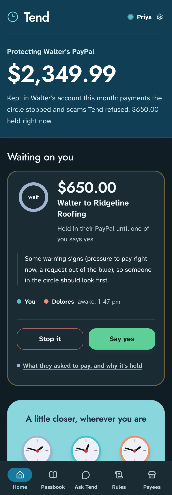 | 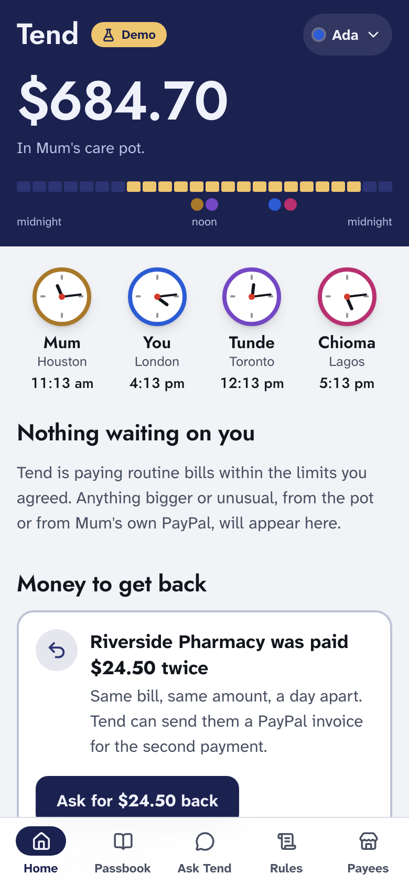 | 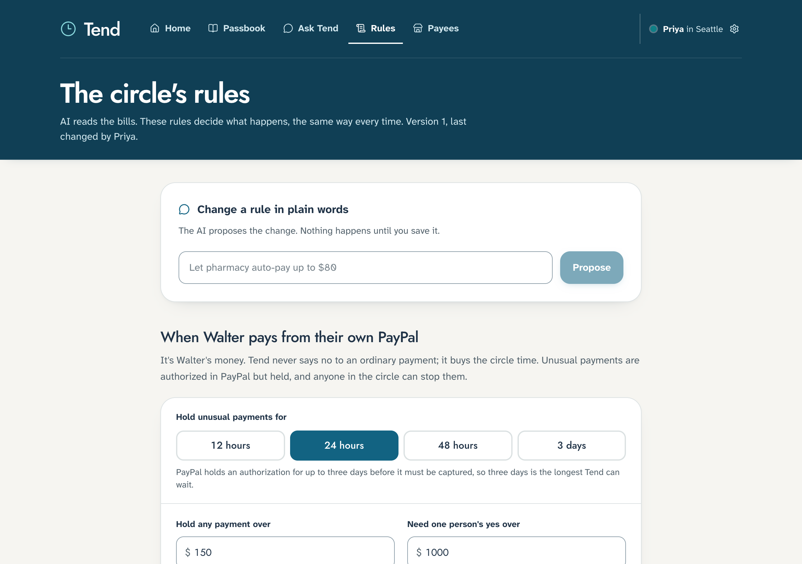 |

## Scripts

```bash
npm test               # 96 tests: rules engine, own payments and holds, Vault, MCP server, pipeline, sign-in, phone alerts, dashboard data and its assistant, demo mode end to end
npm run typecheck
npm run db:reset       # wipe and reseed both circles (Okafors: five weeks of history, Walter: twelve)
npm run mcp:demo       # talk to the MCP server the way an AI assistant would
npm run eval:intake    # score the reader (add -- --offline for the keyword reader)
```

## Deploy (Render)

**New → Blueprint**, pick this repo, fill in the secrets you have, deploy. The start command seeds both demo circles on first boot. It uses paid plans so the demo never sleeps and its database never expires: a Starter web service, a Basic database and the cron job. To run it free, set both plans to `free` and delete the cron block; holds still settle whenever someone opens the app, but the app sleeps after 15 minutes idle. Set `TEND_ALLOW_RESET=0` to hide the reset button on a public deploy. No `APP_URL` is needed on Render: Tend uses the `RENDER_EXTERNAL_URL` Render sets for invite links, redirects and PayPal return URLs. If you paste your local `.env` into the Environment tab, leave out `APP_URL`, `DATABASE_URL` and `CRON_SECRET`. For PayPal webhooks, add one in the sandbox app pointing at `<url>/api/webhooks/paypal` and set `PAYPAL_WEBHOOK_ID` to its id.

## Going live

Tend runs on PayPal sandbox until its settings say otherwise; going live needs no code changes. On the live deploy:

- `PAYPAL_ENV=live`, with the live app's `PAYPAL_CLIENT_ID` and `PAYPAL_CLIENT_SECRET` (developer.paypal.com → Apps & Credentials → Live).
- `PAYPAL_WEBHOOK_ID` from a webhook on the live app pointing at `<url>/api/webhooks/paypal`.
- `TEND_MCP_TOKEN`: Tend keeps the MCP server closed on live PayPal without one.
- No `SANDBOX_*_EMAIL` values: they only feed the example circles.
- A database that doesn't expire (the Blueprint's Basic plan doesn't).

The example circles switch themselves off on live PayPal, and anywhere else with `TEND_EXAMPLES=0`. Nothing made up is loaded on boot, the front page only offers **Set up Tend for someone**, `/demo` and the reset are closed, `db:reset` refuses to wipe anything, and links by first name stop working. Everyone gets in from their own signed invite link.

## Tech

Next.js 16 · React 19 · Tailwind 4 · Drizzle ORM on Postgres (PGlite locally) · Vercel AI SDK 7 (Claude Sonnet 5.5 by default, on the Claude API or through OpenRouter) · Model Context Protocol (Streamable HTTP) · PayPal Orders v2 (authorize, capture, void), Vault v3, Payouts, Invoicing, Agent Toolkit, JS SDK v6, Webhooks · AG Grid Community 36 · AG Studio 3 · Channel3 · Render · Vitest.

## Limits of this hackathon build

- "Viewing as" stands in for sign-in. All people, payees and history are seed data.
- PayPal sandbox only. When a held payment is released, Tend captures it to its own sandbox merchant account and forwards it to the payee by Payout. A production version would make the payee the merchant of record (PayPal's partner and platform APIs) so the money moves once.
- Alerts are Web Push to browsers and Home Screen apps; there are no text messages yet.
- Shopping pays the shop by Payout to a merchant account the circle has verified. A production version would check out through the retailer.

## License

MIT — see [LICENSE](LICENSE).
