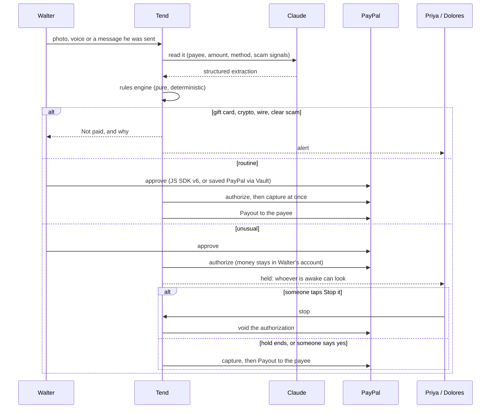

# Tend

**Their money, their say. A second key for the people they trust.**

Tend lets an older adult keep paying from their own PayPal, and gives the people they trust time to stop anything that looks wrong. Routine bills go straight through. Anything unusual is **authorized but held** in their PayPal for a day; anyone in their circle can stop it, and PayPal voids the hold so the money never leaves. Gift cards, crypto, wire transfers and clear scams are refused before any money moves. Built on **PayPal** (Orders authorize/capture/void, Vault, Payouts, Invoicing, Agent Toolkit, JS SDK v6, Webhooks) and **Claude**.


## The problem

- People over 60 reported **$7.75 billion** in fraud losses to the FBI in 2025, **up 59%** on 2024. The average loss was **$38,500**. (FBI IC3 2025 report)
- Scammers now use **PayPal's own invoices and money requests**. The email really is from PayPal; the trap is a "support" phone number typed into the note. PayPal's help centre warns about it.
- **Time breaks scams.** Since October 2024, UK banks may **hold a suspicious payment for up to four business days** (FCA FG24/6). The people an older adult trusts have no such power over their payments.
- Brokerages must ask for a **trusted contact** (FINRA Rule 4512). Everyday payment apps have no such role.
- **26% of Americans 65+ live alone** (Pew). Many have no children, or none nearby, and are the least served.

The usual answers take control away: a joint account, power of attorney, a card someone else manages. Tend keeps the person in charge and adds one thing: **time for a second look**.

## Two circles, two stories

| | **Walter's circle** | **The Okafor family** |
| --- | --- | --- |
| Who | Walter, 84, lives alone in Tucson. No children. His niece Priya in Seattle and his neighbour Dolores are his second key | Mum in Houston. Her children Ada, Tunde and Chioma in London, Toronto and Lagos |
| Money | Walter's **own PayPal**. Nobody else can spend it | Walter's model, plus a **shared care pot** the children pay into |
| What Tend does | Pays his routine bills; **holds** anything unusual for 24 hours; refuses scams; tells Priya and Dolores, whoever is awake | Pays care bills from the pot within the family's rules; asks whoever is awake about bigger ones; collects shares by PayPal invoice; gets double payments back |

| Walter's screen | Before he pays someone new | A real PayPal invoice with a fake number | Dolores, next door |
| --- | --- | --- | --- |
|  |  |  |  |

## Try it in two minutes (no keys needed)

```bash
npm install
npm run db:seed      # embedded Postgres in ./.data, nothing to install
npm run dev          # http://localhost:3000
```

With no keys Tend runs in **demo mode**: PayPal is simulated (every order, authorization, payout and invoice gets a `SIM-` id and is labelled), and messages are read by a keyword reader instead of Claude. Everything else is the real code: the rules engine, holds, approvals, the ledger, the MCP server. `/setup` shows what's connected and which key switches on what.

**Walter's story (the second key)**

1. On `/`, pick **Walter**. Open **Try it with an example** and send **Pharmacy refill**. Approve with PayPal: it's paid at once, because Walter has paid Saguaro Pharmacy before.
2. Send **A roofer at the door** ($650 to someone new). Tend explains it will hold the money in Walter's PayPal for a day. Approve with PayPal: **Held for now**.
3. Go back to `/` and pick **Dolores**. The held payment is at the top with a 24-hour ring. Tap **Stop it**: PayPal voids the authorization and the money never left.
4. As Walter, send **A PayPal invoice email**. Tend recognises the fake support number: *"You don't owe this. Don't call the number."*
5. Send **A Medicare card fee**. Medicare never charges for a card, so it's held until Priya or Dolores says yes.
6. As Priya, open **Ask Tend** and ask *"Is anything of Walter's held right now?"*, then say *"stop it"*.

**The Okafor family (a shared care pot)**

1. Pick **Mum** and send the **Carer's invoice**. Tend asks the family and says who's awake. Approve as Ada, then switch to Tunde (top right) and approve again. It's paid by PayPal Payout.
2. As Mum, send **A worrying text** (a "grandchild" asking for gift cards). Refused, and the family is told.
3. On the family home, **Money to get back** shows a pharmacy bill paid twice. Ask for it back: Tend sends the pharmacy a PayPal invoice.
4. In **Passbook**, ask *"pharmacy payments this month"*.

`/setup` → **Reset the demo** puts everything back.

## Make it real (PayPal sandbox + Claude)

Copy `.env.example` to `.env` and fill in what you have. Each key switches one part to the real thing.

| Key | Where | Switches on |
| --- | --- | --- |
| `ANTHROPIC_API_KEY` | console.anthropic.com | Claude reads photos, voice and texts; Ask Tend becomes a tool-using agent; rules and passbook questions in plain English |
| `PAYPAL_CLIENT_ID`, `PAYPAL_CLIENT_SECRET` | developer.paypal.com → Apps & Credentials → **Sandbox** → a Merchant app with **Payouts**, **Invoicing** and **Vault** ticked | Real sandbox authorizations, captures, voids, payouts, invoices and saved wallets. The JS SDK v6 buttons get a client token from the server, so no public client ID is needed |
| `SANDBOX_*_EMAIL` | developer.paypal.com → Testing tools → Sandbox accounts (one Personal account can be reused) | Where payouts and share invoices go, and the accounts Mum and Walter approve with. Run `npm run db:reset` after setting them |
| `PAYPAL_WEBHOOK_ID` | your sandbox app's webhooks, once deployed | Signature-verified webhooks; locally Tend polls instead |
| `CHANNEL3_API_KEY` | trychannel3.com (free tier) | Shopping searches real retailers instead of a sample catalogue |
| `TEND_MCP_TOKEN` | any secret you choose | Requires a bearer token on the MCP server (it is open in demo and sandbox mode, closed on live PayPal without one) |

## How the second key works



| Walter sends | Tend does | Why |
| --- | --- | --- |
| Pharmacy refill, $38.20 | **Pays it** straight away | Paid before, under $150 |
| A roofer at the door, $650 | **Holds it for 24 hours**; Priya and Dolores can stop it or let it go | First payment to someone new |
| "Medicare Card Services: pay the $89 replacement fee" | **Holds it until someone says yes** | Warning signs: an agency asking for a fee, pressure, out of the blue |
| A real PayPal invoice with a phone number in the note | **Refuses**: "You don't owe this. Don't call the number." | PayPal never puts a support number in an invoice note |
| "It's me, buy gift cards, don't tell anyone" | **Refuses** and alerts the circle | Gift cards are blocked; impersonation, secrecy |
| Anything over $1,000 | **Holds it until someone says yes** | The circle's rule |

The circle sets the rules (hold length 12 to 71 hours, the amounts, holding new payees) on `/rules`, by hand or in a sentence: *"hold anything over $200 for 2 days"*. Holds never exceed 71 hours, inside PayPal's three-day honor period for capturing an authorization. A needs-a-yes payment that nobody answers is voided after three days, so silence never pays.

## Where PayPal is used

| Capability | PayPal technology | Code |
| --- | --- | --- |
| The cooling-off hold | **Orders v2** with `intent: AUTHORIZE`; **Authorizations** capture and void | `src/lib/own-payments.ts`, `src/lib/paypal/rest.ts` |
| The person approves a payment or a top-up | **JS SDK v6** (`createInstance`, `findEligibleMethods`, PayPal one-time payment session) with a server-made **client token** | `src/components/paypal-approve.tsx`, `src/app/api/paypal/client-token/route.ts` |
| Regular bills without a PayPal screen each time | **Vault / Payment Method Tokens v3** (setup token → payment token), charged with `payment_source.paypal.vault_id`, only to payees and amounts the person agreed | `src/lib/vault.ts` |
| Paying pharmacies, carers and payees on release | **Payouts**, idempotent on the payment id | `src/lib/agent/executor.ts`, `src/lib/own-payments.ts` |
| Verifying a new payee | **Payouts**: one cent with a four-digit code in the note | `src/lib/payees.ts` |
| Siblings paying their share; getting a double payment back | **Agent Toolkit** `create_invoice`, `send_invoice`, `get_invoice` | `src/lib/contributions.ts`, `src/lib/recoveries.ts` |
| Ask Tend looks things up | **Agent Toolkit** read-only tools (`list_transactions`, `list_invoices`, `get_invoice`, `get_order`, `list_disputes`, `get_dispute`) | `src/lib/paypal/toolkit.ts`, `src/lib/agent/assistant.ts` |
| Settlement | **Webhooks** (`PAYMENT.PAYOUTS-ITEM.*`, `INVOICING.INVOICE.PAID`, `PAYMENT.AUTHORIZATION.VOIDED`, `PAYMENT.CAPTURE.COMPLETED`) with signature verification, plus polling and a cron job that also releases holds that have ended | `src/app/api/webhooks/paypal/route.ts`, `src/app/api/sync/route.ts` |
| Spotting scams that use PayPal itself | Claude's extraction marks real PayPal invoices and money requests that carry a phone number; the rules engine refuses them with a PayPal-specific reason | `src/lib/agent/intake.ts`, `src/lib/mandate/engine.ts` |

The Agent Toolkit ships AI SDK v4 tool objects; Tend runs AI SDK v7. `toolkit.ts` re-wraps each tool and keeps PayPal's own `execute()`. Tools that create or send invoices are only ever called by Tend's server code, never handed to the model.

## Where AI is used

All Claude calls go through the Vercel AI SDK (`claude-sonnet-5-5` by default; override with `TEND_MODEL`).

- **Reading** (`src/lib/agent/intake.ts`): a photo, voice transcript or forwarded message becomes a typed extraction: payee, amount, category, reference, the payment method asked for, a one-sentence summary for the person, scam signals with a risk score, and whether it's a PayPal-native invoice or money request with a phone number to call.
- **Ask Tend** (`src/lib/agent/assistant.ts`): a tool-using agent over the ledger, held payments, everyone's clocks, the duplicate hunter, shopping and PayPal's read-only tools. It can stop a held payment; it can only *propose* payments and rule changes.
- **Rules in plain English** (`src/lib/rules.ts`) and **questions to the passbook** (`src/lib/agent/passbook-query.ts`): Claude returns structured changes or filters; pure code validates them; a person saves.
- **Shopping** (`src/lib/shopping.ts`): Claude picks one of three in-stock options and says why. Buying goes through the rules like any bill.

Each has an offline stand-in (`src/lib/agent/offline.ts`), labelled wherever it answers. `npm run eval:intake` scores the reader on 20 real-looking inputs, including PayPal invoice and money-request scams, a Medicare card fee and messages that only mention money (18/18 for the offline reader; the two photos need Claude).

## Tend as an MCP server

Any assistant about to help someone pay can ask the circle's second key first. Tend serves MCP over Streamable HTTP at `/api/mcp` (`src/lib/mcp/server.ts`):

| Tool | Does |
| --- | --- |
| `check_payment_request` | Reads a bill, invoice, text or email and says what Tend would do: pay, hold, wait for a yes, or refuse, with reasons. Saves nothing |
| `list_held_payments`, `circle_overview`, `explain_payment` | What's held and why, what was stopped, and every step PayPal and the circle took |
| `search_passbook`, `get_rules`, `list_circles` | The ledger in plain words, the circle's rules, who's awake |
| `stop_held_payment` | The only action: voids a held authorization, for a named person in the circle. Nothing here can send money |

```bash
claude mcp add --transport http tend http://localhost:3000/api/mcp
npm run mcp:demo     # a scripted session against any Tend URL (TEND_URL=...)
```

In Claude.ai or Claude Desktop: Settings → Connectors → Add custom connector, and paste the deployed `/api/mcp` URL.

## Sponsor tools

- **AG Grid Community** (`src/components/passbook-grid.tsx`): the passbook explorer, themed from Tend's tokens with the Theming API. Natural-language questions become an **external filter** with removable chips; a **pinned totals row** recomputes on every filter and keeps money that was held, stopped or refused out of the totals; status pills; struck-through amounts for money that never left; quick search; per-column filters; CSV export; person-coloured cells; responsive columns (one signed Amount column on phones); circles without a pot hide the pot-only columns.
- **Render** (`render.yaml`): one Blueprint creates Postgres, the web service (health-checked at `/api/health`, seeds both demo circles on first boot) and a cron job that calls `/api/sync` every five minutes to settle payouts and **release holds that have ended**. Free Render Postgres expires after 30 days, so if `DATABASE_URL` stops answering Tend falls back to its embedded database, reseeds the demo and says so on `/api/health`, instead of going dark mid-judging.
- **Channel3** (`src/lib/shopping.ts`): product search across retailers for the shopping agent.

| Passbook (Walter's circle) | Passbook (a shared pot, dark) |
| --- | --- |
|  |  |

## The safety model

1. **The person stays in charge.** Tend never refuses an ordinary payment from their own money. It holds unusual ones, and only for as long as the circle agreed.
2. **The model never holds a money-moving tool.** It reads and proposes. In Ask Tend and over MCP, the only action is stopping a held payment.
3. **Decisions are deterministic.** `src/lib/mandate/engine.ts` is a pure function: same input, same answer, with reasons in plain words. Precedence is refuse > needs a yes > hold > pay.
4. **Holds are PayPal's, not Tend's.** The money sits in the person's account as an authorization. Stopping it is a PayPal void; nothing to claw back.
5. **Silence never pays a risky payment.** A needs-a-yes payment is voided after three days if nobody answers. A cooling-off hold releases only after its time runs out, and anyone can stop it until then.
6. **The rules are versioned and guarded.** Every change is a new version with who changed what; loosening changes are flagged; gift cards can never be unblocked; the person at the centre can't approve their own risky payments.
7. **One code path pays,** claiming each payment with a conditional update so a webhook, a cron job and a button press can't both pay. Each payout's `sender_batch_id` is the payment id.
8. **Vault consent is narrow.** A saved PayPal pays only the payees the person ticked, only up to the amount they set, and they can revoke it.
9. **Everything explains itself,** with an audit trail stamped in each person's own time zone.
10. **Tend handles money, not care decisions.** It never gives medical or financial advice.

## Design: the clock wall

Diaspora homes and bank halls have a row of clocks labelled with cities. Tend's interface is that wall: one live dial per person, night indigo when they're asleep, so a held payment always says who can look *now*. Each person keeps one colour everywhere. Amounts and times share one numeral system (Jost). Every line people read uses Atkinson Hyperlegible Next, designed for low-vision readers. The person's own screen has three big actions, three text sizes and spoken answers. Light and dark both work. The design record is in `DESIGN.md`.

| The circle's home (dark) | The Okafor family home | Rules for their own payments |
| --- | --- | --- |
|  |  |  |

## Scripts

```bash
npm test               # 61 tests: rules engine, own payments and holds, Vault, MCP server, pipeline, demo mode end to end
npm run typecheck
npm run db:reset       # wipe and reseed both circles with five weeks of history
npm run mcp:demo       # talk to the MCP server the way Claude would
npm run eval:intake    # score the reader (add -- --offline for the keyword reader)
```

## Deploy (Render)

**New → Blueprint**, pick this repo, fill in the secrets you have, deploy. The start command seeds both demo circles on first boot. The cron job is optional (Render cron jobs are a paid service type); delete its block to stay on the free tier, and holds will still settle whenever someone opens the app. Set `TEND_ALLOW_RESET=0` to hide the reset button on a public deploy.

## Tech

Next.js 16 · React 19 · Tailwind 4 · Drizzle ORM on Postgres (PGlite locally) · Vercel AI SDK 7 with Claude · Model Context Protocol (Streamable HTTP) · PayPal Orders v2 (authorize, capture, void), Vault v3, Payouts, Invoicing, Agent Toolkit, JS SDK v6, Webhooks · AG Grid Community 36 · Channel3 · Render · Vitest.

## Limits of this hackathon build

- "Viewing as" stands in for sign-in. All people, payees and history are seed data.
- PayPal sandbox only. When a held payment is released, Tend captures it to its own sandbox merchant account and forwards it to the payee by Payout. A production version would make the payee the merchant of record (PayPal's partner and platform APIs) so the money moves once.
- The circle is told on screen. Tend shows who's awake; it doesn't send push notifications or texts yet.
- Shopping pays the shop by Payout to a merchant account the circle has verified. A production version would check out through the retailer.

## License

MIT — see [LICENSE](LICENSE).
